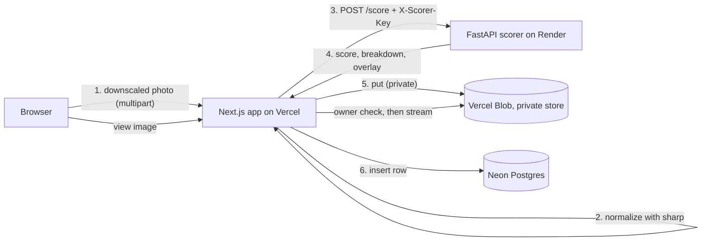

# smile-score-app

## What it does

Upload a photo of a face and get a smile score from 0 to 100, with a breakdown (mouth smile, eye crinkle, mouth open) and a face overlay drawn on the photo. Scoring runs on a separate Python service using MediaPipe's Face Landmarker, so the same photo always gets the same score and the image never leaves our own servers. Each user has a private history of their uploads.


<!-- The owner adds docs/screenshot.png. -->

## Live demo

- Web app: `<VERCEL_URL>`
- Scorer API docs: `<RENDER_URL>/docs`
- Test account on request.

## Architecture



Upload flow:

1. The browser shrinks the photo to at most 1600px on its longest side and re-encodes it as JPEG. This keeps the request under Vercel's 4.5 MB body limit.
2. `POST /api/uploads` (a Route Handler, not a Server Action) checks the session and the consent flag, then checks the type and size (at most 4 MB).
3. `sharp` auto-rotates from EXIF, resizes to fit 1600x1600 and re-encodes to JPEG, which strips all metadata including GPS.
4. The normalized JPEG goes to the scorer (`X-Scorer-Key` header, 30 s timeout). If the scorer finds no usable face, the user gets a friendly error and nothing is stored.
5. The image is stored in a private Blob store at `uploads/{userId}/{uuid}.jpg`.
6. The `uploads` row is inserted. If the insert fails, the blob is deleted (best effort).
7. The route returns `{ id }` and the client navigates to `/results/{id}`.

Scoring happens before storage, so a failed score never leaves an orphaned file. Images are read through `GET /api/uploads/[id]/image`, which looks up the row by both `id` and `user_id` and returns 404 (not 403) when it isn't found.

## How the smile score works

```
mouth = mean(mouthSmileLeft, mouthSmileRight)
eyes  = mean(cheekSquintLeft, cheekSquintRight)
open  = jawOpen
gate  = clamp(mouth / MOUTH_GATE, 0, 1)
raw   = W_MOUTH*mouth + gate*(W_EYES*eyes + W_OPEN*open)
score = round(100 * clamp((raw - FLOOR) / (CEIL - FLOOR), 0, 1))
```

All inputs are MediaPipe blendshape values between 0 and 1.

- **Mouth smile** (`mouth_smile`): how far the mouth corners are pulled up. This is the main signal.
- **Eye crinkle** (`eye_crinkle`): the cheek squint that accompanies a genuine ("Duchenne") smile.
- **Mouth open** (`mouth_open`): jaw opening, which adds a little for a broad smile.
- **The gate:** the eye and mouth-open terms only count in proportion to the mouth smile, so a squint or a yawn alone can't score.

Current constants, from `apps/scorer/app/config.py`:

| Constant | Value |
|---|---|
| `W_MOUTH` | 0.75 |
| `W_EYES` | 0.15 |
| `W_OPEN` | 0.10 |
| `MOUTH_GATE` | 0.30 |
| `FLOOR` | 0.05 |
| `CEIL` | 0.85 |

Current `MODEL_VERSION`: `face_landmarker_f16_v1+formula_v1`. Any constant change must bump `FORMULA_VERSION`. Each upload stores the raw blendshapes and the `model_version`, so scores can be re-tuned and audited without reprocessing images.

**Calibration.** `apps/scorer/scripts/calibrate.py` scores every `*.jpg` in a directory (default `tests/fixtures/calibration`). Each filename starts with a human label from 0 to 100, for example `050_slight.jpg`. It prints the label against the predicted score per photo, the mean absolute error, and how many pairs are ranked in the wrong order. Run it from `apps/scorer`:

```bash
python scripts/calibrate.py [dir] [--model models/face_landmarker.task]
```

### Calibration notes

<!-- Owner fills in: number of photos, MAE `<MAE>`, mis-ordered pairs `<N>`, and what was tuned. -->
- Photos: `<N>`
- Mean absolute error: `<MAE>`
- Mis-ordered pairs: `<PAIRS>`

## Running locally

Prerequisites: Docker, Node with pnpm, and (for non-Docker scorer runs) Python 3.12.

```bash
docker compose up -d            # postgres:16 on 5432, scorer on 8000
cd apps/web
pnpm install
cp .env.example .env.local      # then fill in BETTER_AUTH_SECRET
pnpm db:migrate
pnpm dev                        # http://localhost:3000
```

Leave `BLOB_READ_WRITE_TOKEN` empty locally; images then go to a local-disk adapter. `SCORER_API_KEY` in `.env.local` must match the scorer's (`dev-scorer-key` in `docker-compose.yml`).

To run the scorer without Docker:

```bash
cd apps/scorer
uv venv --python 3.12           # or: python3.12 -m venv .venv
source .venv/bin/activate
uv pip install -r requirements-dev.txt   # or: pip install -r requirements-dev.txt
bash scripts/download_model.sh models
SCORER_API_KEY=dev-scorer-key uvicorn app.main:app --port 8000
```

## Tests

Web (from `apps/web`):

```bash
pnpm lint
pnpm typecheck
pnpm test
```

Scorer (from `apps/scorer`, with the venv active):

```bash
ruff check .
ruff format --check .
pytest
```

The model-dependent scorer tests skip when `models/face_landmarker.task` is missing (run `scripts/download_model.sh models`). The smile-ordering test also skips unless the owner's fixtures (`neutral.jpg`, `small_smile.jpg`, `big_smile.jpg` in `apps/scorer/tests/fixtures`) are present.

## Key decisions

The full table is in [docs/DECISIONS.md](docs/DECISIONS.md). The main ones:

- **A separate Python scorer** (#2, #4): MediaPipe's JS package targets browsers, and scoring in the browser would let a client forge its own score.
- **MediaPipe blendshapes** (#3): continuous, deterministic, free, and the image stays on our servers.
- **Auth checked in every handler** (#5, #6): Better Auth with sessions in our own Postgres; `proxy.ts` only redirects, because middleware-only checks have been bypassed before (CVE-2025-29927).
- **Private image storage behind an owner-checked route** (#10): no guessable public URLs.
- **Normalize and score before storing** (#11, #12): fixes phone EXIF rotation, strips metadata and leaves no orphaned files.
- **Server-enforced consent and 30-day retention** (#24, #25): the privacy controls live on the server, not just in the UI.

## Known limitations

- No OAuth, email verification or password reset.
- No detection of fake, stock or AI-generated photos (the app isn't public, so there's no abuse incentive).
- No HEIC uploads from non-Safari browsers.
- No public sharing and no admin panel.
- The score is a calibrated heuristic, not a validated psychological measure.
- No account deletion. Uploads can be deleted one by one, but deleting a user row directly would orphan that user's blobs.
- No rate limiting beyond Better Auth's defaults.

## Privacy

- **What is stored:** the normalized JPEG (metadata stripped), the smile score and components, the raw blendshapes and the landmark segments used for the overlay. The raw blendshapes are kept so the formula can be re-tuned and audited without reprocessing images (DECISIONS #15).
- **Access:** images are private and only served through the owner-checked route. Nothing is stored when scoring fails.
- **Deletion:** users can delete any upload from its results page. This removes the image and the row (blob first, then row).
- **Consent:** every upload needs the ticked checkbox, and the server rejects uploads without it (`consent_required`), so each row records consent at its `created_at`.
- **Retention:** a daily Vercel Cron job (`/api/cron/purge`, protected by `CRON_SECRET`) deletes photos and their data after `PHOTO_RETENTION_DAYS` days (currently 30).
- **Scorer:** it processes images in memory and never logs or stores them. One caveat: Starlette may spool a multipart part over 1 MB to a temp file, which it deletes at the end of the request.
- **Demo data:** all accounts and photos are deleted when the review period ends.
- **Face geometry:** the landmark segments are biometric-adjacent data ("face geometry" under BIPA; special category data under GDPR Art. 9).

## What I'd do next for production

These were deliberate MVP scope cuts.

- **S3 for storage:** Vercel Blob is enough for a demo; S3 is the production swap behind the same storage adapter.
- **A scoring job queue:** scoring is synchronous inside the upload request, which is fine at demo load but ties request latency to inference.
- **Rate limiting:** only Better Auth's defaults apply today; the scorer is the expensive endpoint to protect.
- **A liveness check:** the app can't tell a live face from a photo of a photo.
- **HEIC support:** needed for non-Safari browsers that send HEIC.
- **Data minimization:** store only the bbox rather than the landmark segments, or offer a "score only, don't keep my photo" mode, to hold less face data.
- **Account deletion and data export** (GDPR Arts. 17 and 20): closes the orphaned-blob gap and gives users control of their data.
- **BIPA-grade written consent and a published retention schedule:** the checkbox and 30-day purge are a start, not a legal standard.
- **Per-user encryption keys, an access audit log, and pinning data to one region:** stronger protection for face data at rest.
